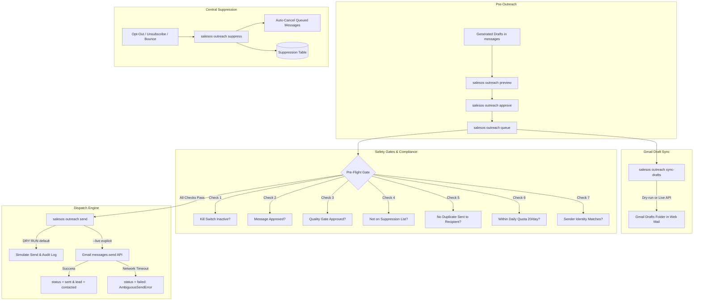

# NexAgentLab SalesOS — Milestone 4 Report
**Gmail OAuth Integration, Controlled Outreach & Central Suppression Engine**

## Executive Summary

Milestone 4 for **NexAgentLab SalesOS** has been successfully designed, implemented, thoroughly tested, and committed to the repository at `G:\nexagentlab_salesOS` (Commit: `da8f244`).

All **149 unit and integration tests** are passing across the test suite (43 Milestone 1 + 43 Milestone 2 + 28 Milestone 3 + 35 Milestone 4), maintaining **zero regressions** and complete backward compatibility with all previous milestones.

The system now autonomously:
1. **Connects to Official Google OAuth 2.0 & Gmail API** with automated token refresh, secret redaction, and strict sender account verification (`nexagentlab.tech@gmail.com`).
2. **Synchronizes Drafts into Gmail Web Interface** (`salesos outreach sync-drafts`) so the agency can visually inspect drafts in `mail.google.com` before any email is dispatched.
3. **Enforces a Resumable Outreach Queue & State Machine** (`draft` -> `approved` -> `queued` -> `sent` / `failed` / `cancelled`) with idempotency keys and ambiguous-send network defense.
4. **Mandates Pre-Flight Safety Checks** (user approval, Quality Gate audit, suppression check, duplicate-recipient prevention, daily send caps, emergency kill switch).
5. **Operates in Dry-Run by Default** (`GMAIL_DRY_RUN=true`), requiring explicit confirmation (`--live`) to dispatch real emails.
6. **Maintains a Central Suppression & Opt-Out System** that normalizes emails, logs auditable reasons, and immediately cancels pending messages for suppressed leads.

---

## Architecture Overview



---

## Key Modules Implemented

### 1. Gmail API Client & OAuth (`src/salesos/gmail_client.py`)
- **Official Google OAuth 2.0**:
  - Minimum necessary scopes: `gmail.compose` (drafts), `gmail.send` (outbound), `userinfo.email` (identity verification).
  - Browser consent URL generation via `generate_auth_url()`.
  - Auth code exchange via `exchange_code_for_token()`.
  - Automatic token refresh against Google's token endpoint (`https://oauth2.googleapis.com/token`) when expired.
- **Strict Sender Verification**:
  - Fetches authenticated Gmail profile (`/users/me/profile`).
  - Verifies email address equals `GMAIL_SENDER` (`nexagentlab.tech@gmail.com`).
  - Aborts immediately with `SenderMismatchError` if authenticated as an unauthorized personal Google account.
- **Secret Redaction**:
  - `redact_secret()` and `redact_token_dict()` ensure tokens, passwords, and client secrets are never printed to terminal or leaked in logs.
- **Ambiguous Send Defense**:
  - Catches network timeouts during message dispatch and raises `AmbiguousSendError`, preventing unsafe automatic duplicate retries.

### 2. Central Suppression Engine (`src/salesos/suppression.py`)
- **Email Address Normalization**: Strips whitespace, standardizes case (`lower()`).
- **Immediate Cancellation**: When an email is suppressed (`record_suppression`), any existing messages in `'draft'`, `'approved'`, or `'queued'` status for that recipient are immediately marked `'cancelled'`.
- **Lead Status Synchronization**: Sets the corresponding lead record in `leads` to `status = 'suppressed'`.
- **Pre-Send Verification**: `is_email_suppressed()` is checked at preview, approval, queueing, and immediately before send dispatch.

### 3. Controlled Outreach Orchestrator (`src/salesos/outreach.py`)
- **Resumable State Machine**:
  - Transitions: `draft` -> `approved` -> `queued` -> `sent` (or `cancelled`, `failed`).
  - Durable idempotency key generated via SHA-256 hash of `message_id`, recipient, and subject.
- **Duplicate Send Prevention**:
  - `has_recipient_been_sent()` blocks any message to a recipient who was already emailed.
- **Quota & Pacing**:
  - Enforces `GMAIL_DAILY_LIMIT` (default 20 sends/day) and conservative pacing between batch dispatches.
- **Emergency Kill Switch**:
  - Respects `CAMPAIGN_KILL_SWITCH=true` to instantly halt all sending across the system.
- **Draft Synchronization**:
  - Creates real Gmail drafts via `create_or_update_draft()` for visual human inspection in Gmail web UI.

### 4. Database Schema Migrations (`src/salesos/db.py`)
Idempotent additions to `messages` table:
- `gmail_draft_id TEXT`: Stored Gmail draft ID.
- `gmail_message_id TEXT`: Confirmed Gmail sent message ID.
- `gmail_thread_id TEXT`: Gmail thread ID.
- `error_message TEXT`: Error details on failure or cancellation reason.
- `approved_at TEXT`: Timestamp when user approved the draft.
- `idempotency_key TEXT`: Unique dispatch hash.
- Indexes: `idx_messages_recipient`, `idx_messages_idempotency`.

---

## Test Verification

Run all tests from PowerShell:
```powershell
python -m pytest tests/ -v
```

**Results:**
- `tests/test_importer.py`: 43 passed (Milestone 1)
- `tests/test_researcher.py`: 43 passed (Milestone 2)
- `tests/test_milestone3.py`: 28 passed (Milestone 3)
- `tests/test_milestone4.py`: 35 passed (Milestone 4)
- **Total: 149 passed, 0 failed, 0 regressions in 16.04s**.

---

## CLI Commands Reference

```powershell
# 1. Gmail OAuth Management
salesos gmail status                    # Check credentials, token validity & sender identity
salesos gmail auth                      # Display authorization URL or complete OAuth flow
salesos gmail auth --code <AUTH_CODE>   # Exchange code for OAuth tokens

# 2. Outreach Pre-Flight & Review
salesos outreach preview 1              # View message metadata, body & safety checklist
salesos outreach approve 1              # Approve message for outreach
salesos outreach approve 1 --force      # Force approve message with review warnings

# 3. Queue & Draft Synchronization
salesos outreach queue                  # Queue approved messages for outbound dispatch
salesos outreach queue --limit 10       # Queue batch limit
salesos outreach sync-drafts            # Sync drafts into Gmail Drafts folder (dry-run)
salesos outreach sync-drafts --live     # Sync real drafts via Gmail API

# 4. Dispatch & Sending
salesos outreach send 1                 # Dry-run dispatch (safe simulation)
salesos outreach send --all-queued      # Dry-run dispatch all queued messages
salesos outreach send 1 --live          # Live dispatch via Gmail API (requires explicit --live)

# 5. Central Suppression & Campaign Status
salesos outreach suppress client@test.com --reason opt_out # Record opt-out and cancel messages
salesos outreach status                 # View campaign volume, quota remaining & kill switch
```

---

## Deliverables & Git Details

- **Branch**: `master`
- **Commit Hash**: `da8f244`
- **Commit Message**: `Milestone 4: Gmail OAuth Integration, Controlled Outreach & Central Suppression`
